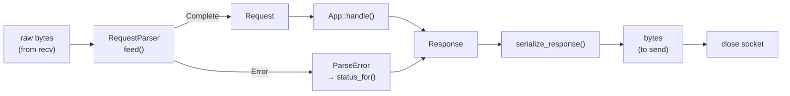
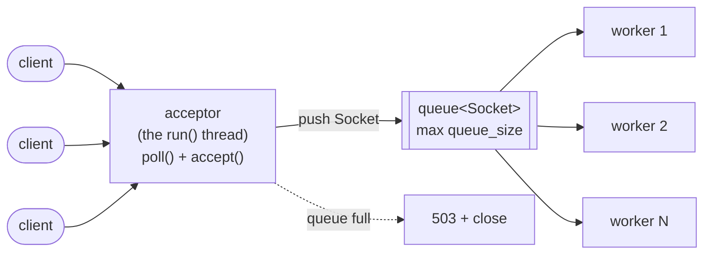
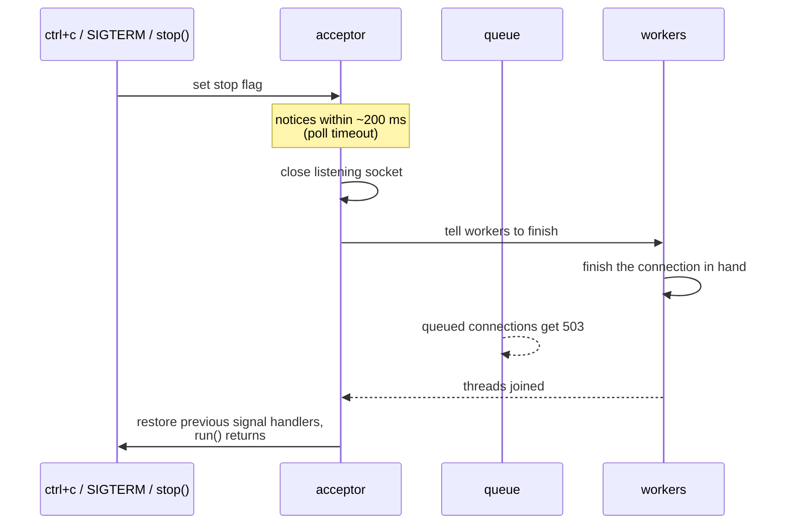

# atlas

a small http/1.x server library in c++20, written from scratch to learn how web servers actually work.

```cpp
atlas::App app;
app["/"] = "Hello World!";
app["/about"] = "About Atlas";
```

that's the whole idea behind the name: an atlas is a book of maps, and an atlas app is a **map of paths**. you put a path in, you get a response out.

atlas is a learning project. the code aims to be simple and readable first, and wherever something tricky is unavoidable (signals, condition variables, a pushdown automaton) the source explains *why* in comments. this readme is part reference, part tour: it walks through what happens to a request from the moment its bytes hit the socket to the moment the connection closes.

> **not production software.** no https, no keep-alive, and one known way for a client to crash the process (see [known limitations](#known-limitations)). use it to read, poke at and learn from.

---

## contents

- [quickstart](#quickstart)
- [building and testing](#building-and-testing)
- [the api](#the-api)
- [how a request flows through atlas](#how-a-request-flows-through-atlas)
- [concurrency and shutdown](#concurrency-and-shutdown)
- [behaviour reference](#behaviour-reference)
- [benchmarks](#benchmarks)
- [known limitations](#known-limitations)
- [what's next](#whats-next)
- [license](#license)

---

## quickstart

```cpp
#include <atlas/atlas.hpp>

int main() {
    atlas::App app;
    app["/"] = "Hello World!";
    app["/about"] = "About Atlas";

    atlas::Server server(app, {.port = 8080});
    server.run();   // blocks until ctrl+c, SIGTERM, or server.stop()
}
```

then, from another terminal:

```sh
$ curl -i http://127.0.0.1:8080/about
HTTP/1.1 200 OK
Content-Length: 11
Content-Type: text/plain
Connection: close

About Atlas
```

and on the server's stdout, one line per request:

```
GET /about 200 0.4ms
```

## building and testing

requirements: linux (or another posix system), cmake ≥ 3.20 and a c++20 compiler. there are no dependencies beyond the standard library and pthreads. it's tested with g++ 15.2 and cmake 4.2.

```sh
cmake -S . -B build
cmake --build build
ctest --test-dir build          # 3 suites: basic_tests, parser_tests, server_tests

./build/atlas_example           # offline demo: raw bytes → parse → handle → serialize
./build/atlas_server            # serves http://127.0.0.1:8080, ctrl+c to stop
```

the cmake targets are:

| target | what it is |
|---|---|
| `atlas` | the library (links `Threads::Threads` publicly) |
| `atlas_example` | [examples/main.cpp](examples/main.cpp): the whole pipeline with no network involved |
| `atlas_server` | [examples/server_main.cpp](examples/server_main.cpp): a real server on 127.0.0.1:8080 |
| `atlas_tests` | [tests/test_basic.cpp](tests/test_basic.cpp): `App`, serializer, reason phrases, `Socket` |
| `atlas_parser_tests` | [tests/test_parser.cpp](tests/test_parser.cpp): every input is fed whole, byte by byte, and in chunks |
| `atlas_server_tests` | [tests/test_server.cpp](tests/test_server.cpp): the server over real loopback sockets |

the server tests take about 3 seconds, because they wait out real timeouts instead of faking them. they also pass under threadsanitizer, which is worth doing whenever you touch the threading code:

```sh
cmake -S . -B build-tsan -DCMAKE_CXX_FLAGS="-fsanitize=thread -g"
cmake --build build-tsan && ctest --test-dir build-tsan
```

there are no install rules yet. to use atlas from another project, add it as a subdirectory and link against `atlas`.

## the api

everything is available through one umbrella header, `#include <atlas/atlas.hpp>`.

### `App`: the map of paths

[include/atlas/app.hpp](include/atlas/app.hpp)

- `app["/path"] = "body";` registers a route or overwrites an existing one. the value is a fixed `text/plain` body.
- a `const` `App` throws `std::out_of_range` from `operator[]` for an unknown path. `contains()`, `get()` (which returns `""` when the path is missing) and `size()` are also available.
- `Response handle(const Request&) const` returns `200` with the body, or `404 Not Found`.

two details that surprise people:

- lookup matches the **exact path string**, query included. `/about?x=1` is not `/about`.
- the **method is ignored**. `GET`, `POST` or `DELETE` on a known path all get the same body.

### `ServerOptions`

[include/atlas/server.hpp](include/atlas/server.hpp). designated initializers work, so you fill in only what you need: `{.port = 3000, .threads = 8}`.

| field | default | meaning |
|---|---|---|
| `host` | `"127.0.0.1"` | ipv4 address to bind to |
| `port` | `8080` | `0` lets the os pick a free port; read it back with `server.port()` |
| `threads` | `4` | worker threads; must be ≥ 1 |
| `queue_size` | `64` | accepted connections that can wait for a worker; must be ≥ 1 |
| `read_timeout` | `5000ms` | longest silence while reading a request before a `408`; must be > 0 |
| `log_requests` | `true` | one line per request on stdout |

(if you're wondering why this struct isn't nested inside `Server` as `Server::Options`, the header explains the c++ rule that prevents it.)

### `Server`

- the **constructor binds and listens immediately**, so `port()` is valid right away. it throws `std::system_error` when the address can't be used (for example `bind 127.0.0.1:8080: Address already in use`), and `std::invalid_argument` for bad options.
- `run()` blocks and serves. it can be called **once**; a second call throws `std::logic_error`.
- `stop()` is safe from any thread, even before `run()` starts. `run()` returns within about 200 ms.
- `port()` returns the port actually bound.
- a `Server` is neither copyable nor movable. it holds the `App` **by reference**, so the `App` must outlive the server and must not be changed while it runs.

## how a request flows through atlas

it helps to think of the server as a pipeline of small, separately testable pieces. most of them know nothing about sockets. [examples/main.cpp](examples/main.cpp) runs the whole pipeline on a hard-coded byte string, with no network at all.



### 1. bytes arrive in arbitrary chunks

tcp is a byte stream, not a message stream. one `recv()` might return half a request line, three requests' worth of data, or a single byte. a parser that assumes "one `recv()` = one request" works on localhost and breaks in the real world.

so [`RequestParser`](include/atlas/request_parser.hpp) is **streaming**. you `feed()` it whatever bytes you have. it tells you how many it consumed, and `status()` says one of three things:

- `NeedMore`: keep reading.
- `Complete`: call `take_request()`.
- `Error`: call `error()`, and turn that into a status code with `status_for()` from [parse_error.hpp](include/atlas/parse_error.hpp).

internally it's a hand-written state machine. the transitions perform actions as bytes go past (mealy style), and the status depends only on the current state (moore style). the parser tests feed every input three ways, whole, one byte at a time and in random chunks, and expect the same result every time. that's the cheapest way to catch "works only if the bytes arrive nicely" bugs.

### 2. strict by default

the parser follows rfc 9112 strictly. it doesn't guess what a malformed request meant, it rejects it:

- line endings must be exactly `CRLF`. a bare `LF` is a `400`.
- `HTTP/1.1` requests must carry exactly one `Host` header.
- header names are tokens, built from the rfc 9110 character classes in [src/char_class.hpp](src/char_class.hpp).

being lenient sounds friendly, but in http it's how request smuggling happens: two programs disagree about where one request ends. strict is simpler *and* safer.

### 3. comments inside headers

http has an odd corner: `User-Agent` and `Via` values may contain parenthesised comments, and those comments can nest:

```
User-Agent: Mozilla/5.0 (X11; Linux x86_64 (nested (deeper)))
```

matching nested brackets is the textbook problem a finite state machine *can't* solve, because it needs memory of how deep you are. so [`CommentPda`](include/atlas/comment_pda.hpp) is a small **pushdown automaton**: a state machine plus a stack. the header comment walks through how the stack grows and shrinks. the result is available as `req.commented("user-agent")`, and nesting is capped at depth 8.

### 4. routing and serialization

once there's a `Request`, routing is a map lookup in `App::handle()`. [`serialize_response()`](include/atlas/serializer.hpp) then turns the `Response` into wire bytes, always writing `Content-Length`, `Content-Type: text/plain` and `Connection: close`. the socket is closed after every response.

the file descriptor itself lives in [`Socket`](include/atlas/socket.hpp), a move-only raii wrapper. a connection can't be leaked or closed twice, whichever path the code takes, including exceptions.

## concurrency and shutdown

### the threading model



- the thread that calls `run()` becomes the **acceptor**. it waits for new connections and pushes each accepted `Socket` onto a bounded queue.
- **N worker threads** pop connections off the queue. each one reads one request, answers it, and closes the socket.
- if the queue is full, the acceptor answers `503` right away instead of letting the backlog grow without limit. this is **backpressure**: under overload, it's better to refuse some clients quickly than to make every client wait.
- handlers run **concurrently**. `App::handle()` is called from several workers at once. today's routes are immutable strings, so that's safe; anything mutable you add later needs a `std::mutex`.

three spots in [src/server.cpp](src/server.cpp) are worth reading slowly:

- **why `poll()` comes before `accept()`** (in `Server::run`). a blocking `accept()` can't notice a stop request, and `poll()` with a timeout can.
- **why the signal flag is a lock-free `std::atomic<bool>` and not `volatile sig_atomic_t`** (top of the file).
- **condition variables and spurious wakeups** (in `Server::worker_loop`): why the wait is always written with a predicate.

### graceful shutdown



- workers **finish the connection they're already handling**. nobody gets cut off halfway through a response.
- connections still waiting in the queue get a `503`.
- `run()` installs handlers for `SIGINT` and `SIGTERM`, and **restores the program's previous handlers** before returning, so atlas doesn't permanently take over your process's signals. the flag is global, though, so only run one `Server` at a time per process.
- ctrl+c takes up to 200 ms to take effect (the poll timeout). in the worst case, shutdown waits up to `read_timeout` for a slow client a worker is still reading from.

## behaviour reference

### what the parser accepts

| thing | rule |
|---|---|
| method | any rfc token |
| version | `HTTP/1.0` or `HTTP/1.1`; any other `HTTP/x.y` → `505` |
| request target | origin form only (`/path…`) |
| line endings | strict `CRLF` |
| `Host` | required for `HTTP/1.1`; duplicates rejected |
| body | read using `Content-Length`; `Transfer-Encoding` → `501` |
| header names | case-insensitive: `req.header("Host")` == `req.header("host")` |

| limit | value | status when exceeded |
|---|---|---|
| request line | 8 kib | `414` |
| one header line | 8 kib | `431` |
| number of headers | 100 | `431` |
| all headers together | 64 kib | `431` |
| body | 1 mib | `413` |
| comment nesting | depth 8 | `400` |

if you talk to atlas by hand with `nc`, remember the `Host` header and the `\r\n` line endings, or you'll get a `400`:

```sh
printf 'GET /about HTTP/1.1\r\nHost: localhost\r\n\r\n' | nc 127.0.0.1 8080
```

### status codes the server can send

| code | when |
|---|---|
| `200` | route found |
| `400` | malformed request, or the client hung up halfway through one |
| `404` | unknown path |
| `408` | no bytes for `read_timeout` while reading a request |
| `413` / `414` / `431` | parser limits (see above) |
| `501` | `Transfer-Encoding` present |
| `503` | every worker busy and the queue full, **or** still queued at shutdown |
| `505` | unsupported http version |

error responses have an empty body. a client that connects and closes without sending anything gets no response and isn't logged.

### the log line

one line on stdout, written after the response has been sent:

```
GET /about 200 0.4ms
- - 400 0.1ms        # no request was parsed, so no method or path
- - 503 0.0ms
```

the time is measured from when a **worker** picks the connection up, so time spent waiting in the queue is *not* included. the spec says "from `accept()`", and this difference is known. errors go to stderr.

## benchmarks

numbers are only worth something with their context, so here's all of it.

**setup**

- amd ryzen 5 7530u (6 cores / 12 threads), linux, laptop on mains power
- g++ 15.2, `-DCMAKE_BUILD_TYPE=Release`
- the stock `atlas_server` example: 4 workers, queue of 64, request logging **on** (stdout sent to `/dev/null`)
- [wrk](https://github.com/wg/wrk) 4.1.0 on the **same machine** over loopback, 10 s per run, `GET /about`
- commit `d787439`

**results**

| connections | wrk threads | req/s | p50 | p90 | p99 | errors / non-2xx |
|---:|---:|---:|---:|---:|---:|---|
| 1 | 1 | 15,818 | 20 µs | 26 µs | 52 µs | 0 |
| 4 | 4 | 22,492 – 24,172 | 30 µs | 38 µs | 61 µs | 0 |
| 16 | 4 | 57,708 | 85 µs | 173 µs | 238 µs | 0 |
| 64 | 4 | 61,029 | 525 µs | 768 µs | 0.96 ms | 0 |
| 256 | 4 | 77,238 total, **~36,000 `200`s** | 0.87 ms | 2.60 ms | 3.35 ms | 53% `503` |

(the 4-connection run was repeated three more times, giving 23,881 – 24,172 req/s.)

**how to read this**

- **every request is a brand-new tcp connection.** wrk would happily reuse connections, but atlas sends `Connection: close` and hangs up, so wrk reconnects every time. these numbers measure *connect + accept + parse + respond + close*, not just http parsing. keep-alive would change the picture a lot.
- **throughput levels off around 60k req/s.** going from 16 to 64 connections barely adds throughput, but quadruples latency. that's queueing in action: once the 4 workers are saturated, extra clients just wait in line.
- **at 256 connections, backpressure kicks in.** the 4 workers plus 64 queue slots can't hold 256 clients, so the acceptor turns away about half of them with a `503`. the headline "77k req/s" is misleading: only ~36k/s were successful `200`s, *fewer* than at 64 connections, because the acceptor is now spending its time on rejections. this is the overload behaviour the bounded queue is designed for. nothing crashed, and the process stayed up through every run.
- **client and server share the cpu**, so wrk steals cycles from atlas. a second machine would give higher, cleaner numbers.
- this is a toy route returning a constant string. it's a measure of the server's overhead, not of any real application.

**reproduce it**

```sh
cmake -S . -B build-release -DCMAKE_BUILD_TYPE=Release
cmake --build build-release --target atlas_server
./build-release/atlas_server > /dev/null &

wrk -t4 -c64 -d10s --latency http://127.0.0.1:8080/about

kill -INT %1
```

## known limitations

being honest about these matters more than the feature list.

- **SIGPIPE is not handled. this is the big one.** if a client disconnects before its response is written, `send()` raises `SIGPIPE`, and the default action for that signal is to **kill the whole process**. the planned fix is `MSG_NOSIGNAL` on every `send()`. (it didn't happen during the benchmarks above, but any client that hangs up at the wrong moment can trigger it.)
- **the read timeout is per `recv()`, not per request.** a slowloris-style client that sends one byte every few seconds can hold a worker for a long time.
- **`503` is sent without reading the request.** if request bytes are still unread when the socket closes, the kernel may send a tcp reset, and the client might never see the `503`.
- **a throwing handler terminates the program** (`std::terminate` on a worker thread). this can't happen with today's string-only routes.
- every response is `text/plain`, and responses can't set custom headers.
- not supported: https, ipv6, keep-alive, chunked bodies, query parsing, percent-decoding, per-method routes, path parameters, static files, or windows.

## what's next

**server follow-ups:** `MSG_NOSIGNAL`, keep-alive, a total per-request deadline, the self-pipe trick so ctrl+c stops the server instantly instead of within 200 ms, and eventually a `poll`/`epoll` event loop instead of a thread per in-flight connection.

**project hygiene:** ci, a sanitizer build option, fuzzing the parser, and repeatable benchmarks.

## license

[mit](LICENSE).
